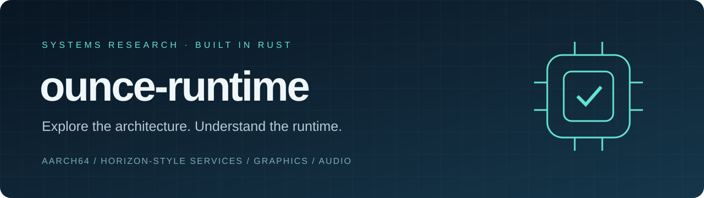
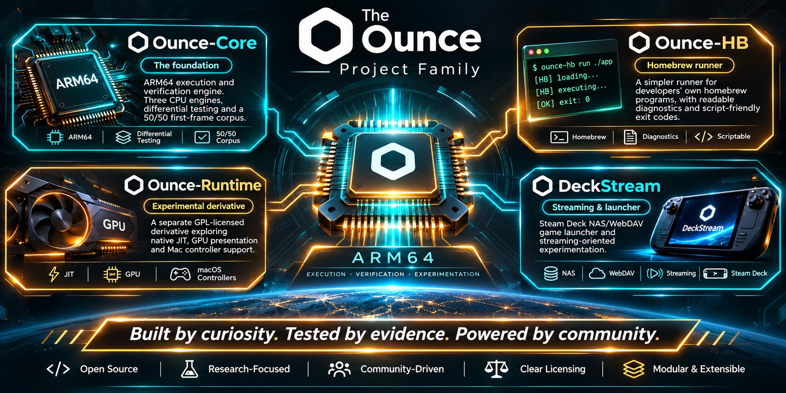

<div align="center">



**Ounce-Runtime runs supported open-source ARM64 homebrew and experiments with faster execution, graphics and controller input.** It is an experimental runtime, not a general-purpose game emulator or an independently validated compatibility product.

[](https://github.com/hffgzktbcc-blip/ounce-runtime/releases/latest)
[](https://github.com/hffgzktbcc-blip/ounce-runtime/actions/workflows/ci.yml)
[](LICENSE)

[**Download**](https://github.com/hffgzktbcc-blip/ounce-runtime/releases/latest) · [**Quick start**](#quick-start) · [**Documentation**](docs/) · [**Contribute**](CONTRIBUTING.md)

</div>

---

## The Growing Family

<p align="center">
  
</p>

> *Built by curiosity. Tested by evidence. Powered by community.*

ounce-runtime is one of four independent, open-source projects sharing an evidence-first philosophy and a community:

**Four independent projects. Choose the job you need done:**

- **[Ounce-Core](https://github.com/hffgzktbcc-blip/ounce-core)** checks supported ARM64 programs against recorded hardware references.
- **[Ounce-HB](https://github.com/hffgzktbcc-blip/ounce-hb)** runs your own open-source homebrew through an engine and explains why it stopped.
- **[Ounce-Runtime](https://github.com/hffgzktbcc-blip/ounce-runtime)** experiments with faster ARM64 execution, graphics and controller input.
- **[DeckStream](https://github.com/hffgzktbcc-blip/deckstream)** aims to launch PC games from your NAS/WebDAV storage on Steam Deck; an independent device run is still outstanding.

**[Choose the right Ounce project in one minute](https://github.com/hffgzktbcc-blip/ounce-core/blob/main/docs/FAMILY.md)** for the first task, limitations, licences and current-release links. These projects have separate evidence and release decisions. DeckStream is not an ARM64 engine, and GPL code is not copied into MIT siblings.

---

## What you can do

- **Run an open-source homebrew test:** try a supported unencrypted NRO and inspect how it stops.
- **Investigate performance or graphics:** compare the project's execution modes and inspect host rendering for your own test inputs.
- **Record a result:** use a machine-readable run report to share an exact outcome, including failures.

The implementation is experimental and only supports tested subsets. See [limits](docs/LIMITS.md) before treating any example as a compatibility promise.

## What ounce-runtime adds

While `ounce-core` focuses on strict differential verification and safe-Rust execution against reference hardware, `ounce-runtime` explores maximum host execution performance and rich host integration:

- **Native Execution (NCE) & Tier-4 JIT**: Direct AArch64 native execution on Apple Silicon hosts, alongside a Cranelift-based optimizing Tier-4 JIT recompiler (`crates/ounce-recompiler`) with dynamic block chaining and inline TLB fast paths.
- **Sparse Fast-Memory Arena (`FastmemArena`)**: A unified 42-bit host virtual memory arena with on-demand page commitment (`mprotect`), consuming 0 physical RSS upfront while mapping guest VRAM and heaps 1:1 for zero-copy DMA and host GPU uploads.
- **Host GPU Presentation**: Real-time rendering via `wgpu` with native Metal, Vulkan, and DirectX 12 backends, including texture decoding pipelines, surface blitting, and compute-based DMA shaders.
- **Physical Controller & Mac Integration**: Native Apple GameController framework bindings, cross-platform physical gamepad input via `gilrs`, and deterministic scripted input playback for automated testing.
- **Comprehensive Service Models**: In-process Horizon-style service emulation spanning NVDRV (graphics driver), SM, HID, FS (RomFS and SDMC), and audio output/rendering (audout/audren).

---

## Architecture

| Subsystem | Components & Capabilities |
| :--- | :--- |
| **CPU Engine** | Multi-tier pipeline: AArch64 interpreter, Tier-2 basic-block JIT, Tier-3 superblock tracing, Cranelift Tier-4 JIT, and Apple Silicon NCE |
| **Memory** | Sparse `FastmemArena`, virtual memory management, guarded pages, and multi-threaded hardware atomics |
| **Graphics** | Host presentation via `wgpu`, NVDRV acceleration, texture unswizzling/tiling, and shader caching |
| **Audio & Input** | Multi-voice polyphony (`audren`), host PCM stream playback (`cpal`), physical controllers, and Apple GameController integration |
| **Loaders** | Unencrypted Switch homebrew NRO, multi-module NSO packages, RomFS, and synthetic NPDM containers |

---

## Quick start

> **Latest published release:** [Open the latest GitHub release](https://github.com/hffgzktbcc-blip/ounce-runtime/releases/latest) for the current tag, downloads and release date. The [changelog](CHANGELOG.md) distinguishes released changes from work on `main`; verify the tagged artifact before claiming a feature shipped. See the [Ounce Family 2026–2027 roadmap](https://github.com/hffgzktbcc-blip/ounce-core/blob/main/docs/roadmap/OUNCE_FAMILY_1_YEAR_ROADMAP.md) for shared direction, not release status.

### Download a prebuilt release

Download the archive for your platform from [Releases](https://github.com/hffgzktbcc-blip/ounce-runtime/releases/latest):
- **macOS Apple Silicon** (`aarch64-apple-darwin`)
- **Linux x86_64** (`x86_64-unknown-linux-gnu`)
- **Linux ARM64** (`aarch64-unknown-linux-gnu`)
- **Windows x86_64** (`x86_64-pc-windows-msvc`)

Extract the archive and run:

```bash
./ounce-runtime info
./ounce-runtime test
```

### Build from source

Prerequisites: a recent stable Rust (edition 2024; CI uses the current stable toolchain). On Ubuntu/Debian, install host audio and device dependencies:

```bash
sudo apt-get install -y libasound2-dev libudev-dev
```

Clone and build:

```bash
git clone https://github.com/hffgzktbcc-blip/ounce-runtime.git
cd ounce-runtime
cargo build --release --locked
```

`native-jit` and `gpu-present` are enabled by default. To build without GPU presentation or native JIT, pass `--no-default-features`.

---

## Commands & Usage

| Command | Description |
| :--- | :--- |
| `cargo run --release -- info` | Print modelled architecture capabilities, active CPU tier, and memory profile |
| `cargo run --release -- test` | Execute the synthetic architecture verification harness (25 stages) |
| `cargo run --release -- jit-selftest` | Validate host native code generation and recompiler caches |
| `cargo run --release -- --present=gpu 3d 300` | Launch the 3D graphics demonstration with host GPU rendering |
| `cargo run --release -- run|run-nro path/to/app.nro` | Execute an unencrypted homebrew NRO program |
| `cargo run --release -- run-nro path/to/app.nro --present=headless --report-json=run.json` | Write an `ounce.run.v1` report for that run. See [docs/QUICKSTART.md](docs/QUICKSTART.md). Included since v0.6.0 |
| `cargo run --release -- help` | Display comprehensive CLI options and flag reference |

---

## Verification & Parity

> Conformance and speed figures below describe the specified trace suite, host and test conditions, not general ARM64 application correctness or guaranteed speed on other hosts.

- **Synthetic Architecture Harness**: 27 architecture checks across 25 stages validating instruction semantics, memory permissions, atomics, and service dispatch.
- **Unit & Integration Suite**: The workspace test suite (`cargo test --release`; run it for the current count) spans JIT compilation, fastmem isolation, RomFS parsing, and IPC serialization.
- **Published ARM64 trace-suite results (bounded evidence)**: 12/12 pass on `conformance/arm64-v0.2.0` (and 1/1 on `arm64-v0.1.0`) across `interp`, `tier3`, `tier4`, and `nce`, including `FPSR.QC` saturation, default quiet NaN propagation, `ADCS`/`SBCS` carry chains, `FEAT_LRCPC2` (`LDAPUR*`/`STLUR*`), and `FEAT_SHA3` (`EOR3`, `BCAX`, `RAX1`, `XAR`).
- **Tri-Engine Tournament**: 100% exit code and execution parity with `ounce-core` across homebrew NROs and Stage 20 scaling (exact 15,304 instruction match across all engines; up to 116.53 MIPS under Apple Silicon NCE). See the [Tri-Engine Tournament Scoreboard](https://github.com/hffgzktbcc-blip/ounce-hb/blob/main/docs/TRI_ENGINE_COMPETITION.md).
- **Corpus Parity**: Head-to-head homebrew execution comparison with `ounce-core` is tracked under `docs/CORPUS_PARITY.md`.

---

## Scope & Responsible Use

ounce-runtime is dedicated to systems architecture research, synthetic workloads, and open-source homebrew development.

- **Clean room & open source**: The repository contains no proprietary firmware, console keys, commercial game assets, or decryption mechanisms.
- **Homebrew only**: Protected retail container decryption is strictly out of scope.
- See [CONTRIBUTING.md](CONTRIBUTING.md) for contribution guidelines and [docs/PROVENANCE.md](docs/PROVENANCE.md) for provenance registers.

---

**GPL-3.0-or-later** · [License](LICENSE) · [Third-party notices](THIRD_PARTY.md)

*Unaffiliated with Nintendo, NVIDIA, or any other entity. All trademarks belong to their respective owners and are referenced solely for interface compatibility documentation.*
