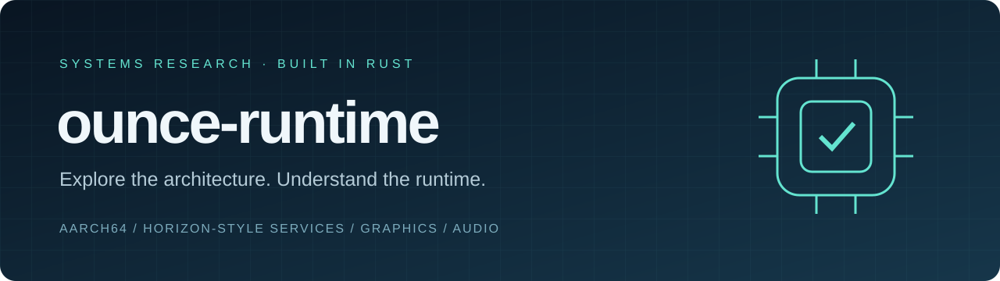

<div align="center">



**A standalone derivative of [Ounce Core](https://github.com/hffgzktbcc-blip/ounce-core), for AArch64 research, synthetic workloads, and homebrew.**

[](https://github.com/hffgzktbcc-blip/ounce-runtime/releases/latest)
[](https://github.com/hffgzktbcc-blip/ounce-runtime/actions/workflows/ci.yml)
[](LICENSE)

[**Download**](https://github.com/hffgzktbcc-blip/ounce-runtime/releases/latest) · [**Quick start**](#quick-start) · [**Documentation**](docs/) · [**Contribute**](CONTRIBUTING.md)

</div>

---

## How this differs from Ounce Core

[Ounce Core](https://github.com/hffgzktbcc-blip/ounce-core) is the original project. **ounce-runtime shares its research-core lineage** and packages a later variant of that code as a separate public release. It includes later Rust-core work also present in Ounce NX2, but excludes NX2's app/library layer and `nxnative` engine integration. It is not the working NX2 game-running application, and its publication does not establish a compatibility improvement over Ounce Core.

The table below compares this repository's **v0.4.0** with the older **Ounce Core v0.3.2 checkout at [`bebfd72`](https://github.com/hffgzktbcc-blip/ounce-core/tree/bebfd72803a05e5d250701255b4c2dca7b39bc98)**. It is a snapshot comparison, not a description of everything on Ounce Core's current `main`.

| Area | Original Ounce Core snapshot | ounce-runtime v0.4.0 |
| :--- | :--- | :--- |
| **Shared foundation** | AArch64 interpreter and tiered execution, Horizon-style services, graphics, audio, input, loaders, and synthetic harness | Retains that foundation; this is a derivative, not an independently built replacement |
| **Default build** | Native JIT and GPU presentation opt-in | `native-jit` and `gpu-present` enabled by default |
| **CPU & memory** | Interpreter and tiered recompiler with the earlier memory implementation | Later CPU/recompiler changes, an in-tree AArch64 native-execution engine, and a sparse fast-memory arena |
| **Graphics** | Earlier software and host-GPU research implementation | Additional compute/DMA backend, texture-decoding, and shader-cache code; these additions do not establish commercial-game compatibility |
| **Mac input & diagnostics** | Earlier host controller integration | Apple GameController integration, scripted input, and additional tracing |
| **Safe-code boundary** | Root crate forbids unsafe Rust; native recompiler has its own boundary | Controlled unsafe code also exists inside `src`, including native execution, memory, and Mac controller bindings; the original safe-core guarantee does not carry over |
| **Distribution** | Original project and its release history | Separate repository and Linux, macOS, and Windows archives; v0.4.0 also fixes cross-platform audio-module gating and portable memory bounds |

Ounce Core has continued evolving separately. Later work there, including its separate `ounce-nce` crate and homebrew first-frame oracle programme, must be assessed in that project's own [documentation](https://github.com/hffgzktbcc-blip/ounce-core#readme) and CI. Those results are not inherited by this repository, and no equivalent head-to-head compatibility or performance comparison has been established here.

**What is verified here:** the v0.4.0 release passed the nine Linux/macOS/Windows standard, GPU-presentation, and native-JIT CI jobs, repository cleanliness checks, and an external homebrew execution probe. Local Apple Silicon verification passed 466 tests (2 ignored), all 27 synthetic harness checks across 25 stages, the native-JIT self-test, and a Metal graphics demo. An execution probe is not a first-frame compatibility oracle. These results do not constitute a legal or provenance audit; the open checks remain in [PROVENANCE.md](docs/PROVENANCE.md).

## Architecture you can explore

ounce-runtime brings CPU execution, Horizon-style service models, graphics, audio, and input into one Rust research project. Use it to inspect system behaviour, exercise synthetic test programs, and investigate homebrew interoperability.

| Layer | What is inside |
| :--- | :--- |
| **CPU execution** | AArch64 interpreter, tiered block execution, and a feature-gated native recompiler |
| **System services** | Models of kernel calls, IPC, threads, storage, time, and application services |
| **Graphics** | Software rendering and host GPU presentation through `wgpu` |
| **Audio & input** | Host audio output and physical gamepad integration |
| **Verification** | Unit tests, synthetic architecture stages, and homebrew fixtures |

## Quick start

### Download a release

Get the archive for your platform from [Releases](https://github.com/hffgzktbcc-blip/ounce-runtime/releases/latest): **macOS Apple Silicon**, **Linux x86_64**, or **Windows x86_64**. Extract it and run the executable from a terminal:

```bash
./ounce-runtime info
./ounce-runtime test
```

On Windows, use `./ounce-runtime.exe`. The runtime is a command-line application; graphics demos can open a separate window.

### Build from source

Install a current stable [Rust toolchain](https://rustup.rs/) with edition 2024 support. On Ubuntu, install the host dependencies first:

```bash
sudo apt-get install libasound2-dev libudev-dev
```

```bash
git clone https://github.com/hffgzktbcc-blip/ounce-runtime.git
cd ounce-runtime
cargo build --release --locked
cargo run --release -- info
```

`native-jit` and `gpu-present` are enabled by default. For a build without those optional features, add `--no-default-features`.

## Try the runtime

| Command | Purpose |
| :--- | :--- |
| `cargo run --release -- info` | Inspect the modelled architecture and runtime profile |
| `cargo run --release -- test` | Execute the synthetic architecture harness |
| `cargo run --release -- jit-selftest` | Check native code execution on the host |
| `cargo run --release -- --present=gpu 3d 300` | Run the graphics demo with host GPU presentation |
| `cargo run --release -- run path/to/homebrew.nro` | Execute a homebrew program you supply |
| `cargo run --release -- help` | Show the complete command reference |

## Research status

This is experimental software. Service coverage and instruction support are partial; successful synthetic tests do not establish compatibility with arbitrary applications. See the [CI results](https://github.com/hffgzktbcc-blip/ounce-runtime/actions) for verification on each platform.

The repository contains homebrew fixture sources and prebuilt binaries. Their source attribution comparisons and binary component inventory remain incomplete and are recorded in the [provenance register](docs/PROVENANCE.md) and [third-party notices](THIRD_PARTY.md).

To run local verification:

```bash
cargo test --release
cargo run --release -- test
```

## Scope & contribution

The project focuses on synthetic workloads and open-source homebrew. It does not ship proprietary firmware, keys, or commercial game data. Protected retail content decryption is outside the project scope.

Read [CONTRIBUTING.md](CONTRIBUTING.md) before opening a pull request. Report reproducible problems through [GitHub Issues](https://github.com/hffgzktbcc-blip/ounce-runtime/issues), including the host platform, command, and relevant logs.

---

**GPL-3.0-or-later** · [License](LICENSE) · [Third-party notices](THIRD_PARTY.md)

Unaffiliated with Nintendo, NVIDIA, or any other company. Names and trademarks are used only to describe the interfaces being modelled.
